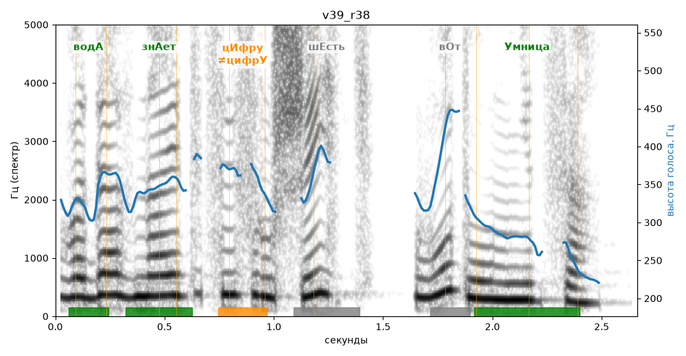

# v39_r38

Естественность (UTMOS): **2.31 из 5** (живой диктор ≈ 4–4.5)
Эталон: Вода знает цифру шесть? Вот умница!
Распознано: Вода знает цифру 6, вот умница.
Расхождения в словах: «шесть» → «6»

## Ударения
(где нужно: ruaccent)

| слово | нужно | у голоса | |
|---|---|---|---|
| вода | водА | водА | ✓ |
| знает | знАет | знАет | ✓ |
| цифру | цИфру | цифрУ | ✗? возможно — послушать |
| умница | Умница | Умница | ✓ |

## Интонация
- ✗ «вода знает цифру шесть?» — нет вопросительного подъёма (самое высокое место — «шесть», в начале) — звучит как утверждение
- ✓ «вот умница!» — выделено слово «вот» (+4.7 пт)
- Диапазон голоса 9.2 полутонов (живо), средняя высота 331 Гц

## Паузы и темп
- паузы на своих местах
- Темп 5.5 слога/с (нормально)

_Синяя линия — высота голоса. Над словами заглавная буква — где ударение должно быть; красным — голос поставил не туда (уверенно), оранжевым — возможно._
