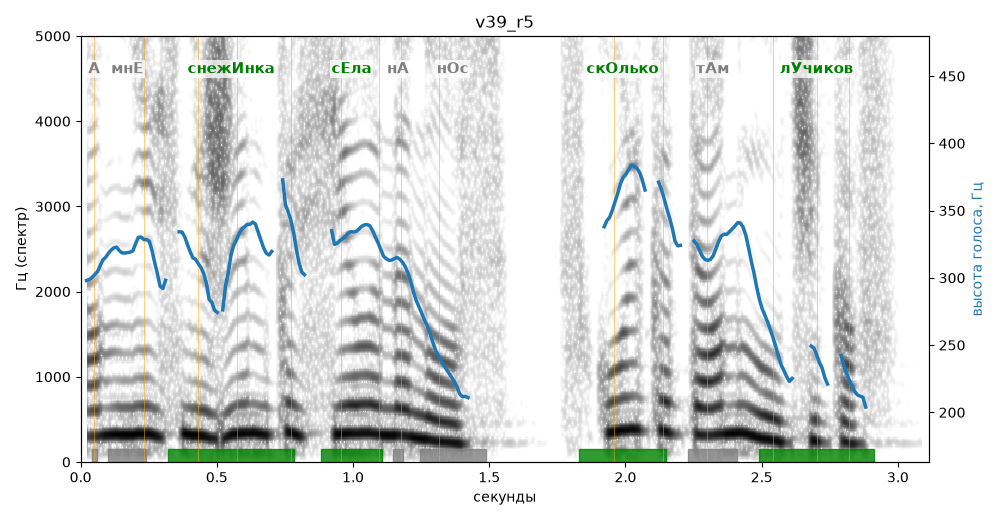

# v39_r5

Естественность (UTMOS): **2.5 из 5** (живой диктор ≈ 4–4.5)
Эталон: А мне снежинка села на нос! Сколько там лучиков?
Распознано: А мне снежинка села на нос, сколько там лучиков?
Слова: все совпали

## Ударения
(где нужно: ruaccent)

| слово | нужно | у голоса | |
|---|---|---|---|
| снежинка | снежИнка | снежИнка | ✓ |
| села | сЕла | сЕла | ✓ |
| сколько | скОлько | скОлько | ✓ |
| лучиков | лУчиков | лУчиков | ✓ |

## Интонация
- ✗ «а мне снежинка села на нос!» — восклицание звучит ровно, без эмоции
- ✓ «сколько там лучиков?» — конец фразы понижается — звучит законченно
- Диапазон голоса 9.0 полутонов (живо), средняя высота 318 Гц

## Паузы и темп
- паузы на своих местах
- Темп 5.9 слога/с (нормально)

_Синяя линия — высота голоса. Над словами заглавная буква — где ударение должно быть; красным — голос поставил не туда (уверенно), оранжевым — возможно._
