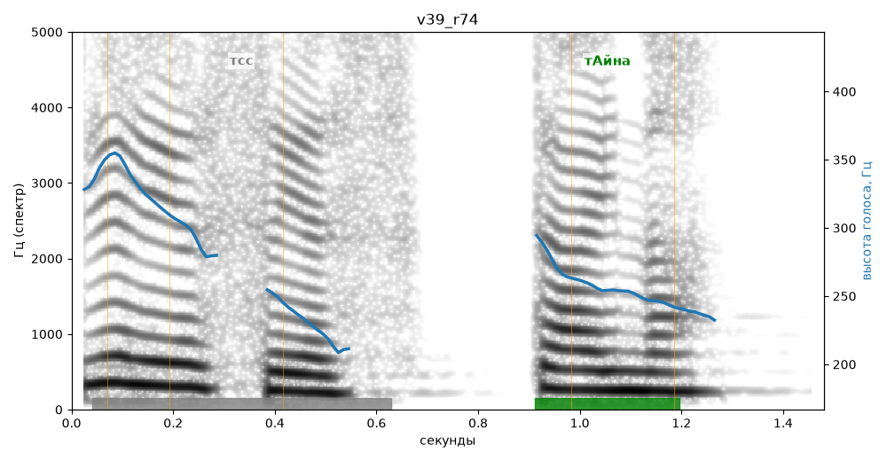

# v39_r74

Естественность (UTMOS): **2.44 из 5** (живой диктор ≈ 4–4.5)
Эталон: Тсс! Тайна.
Распознано: Я СС, Тайна.
Расхождения в словах: «тсс» → «я сс»

## Ударения
(где нужно: ruaccent)

| слово | нужно | у голоса | |
|---|---|---|---|
| тайна | тАйна | тАйна | ✓ |

## Интонация
- Диапазон голоса 8.0 полутонов (живо), средняя высота 255 Гц

## Паузы и темп
- паузы на своих местах
- Темп 5.7 слога/с (нормально)

_Синяя линия — высота голоса. Над словами заглавная буква — где ударение должно быть; красным — голос поставил не туда (уверенно), оранжевым — возможно._
