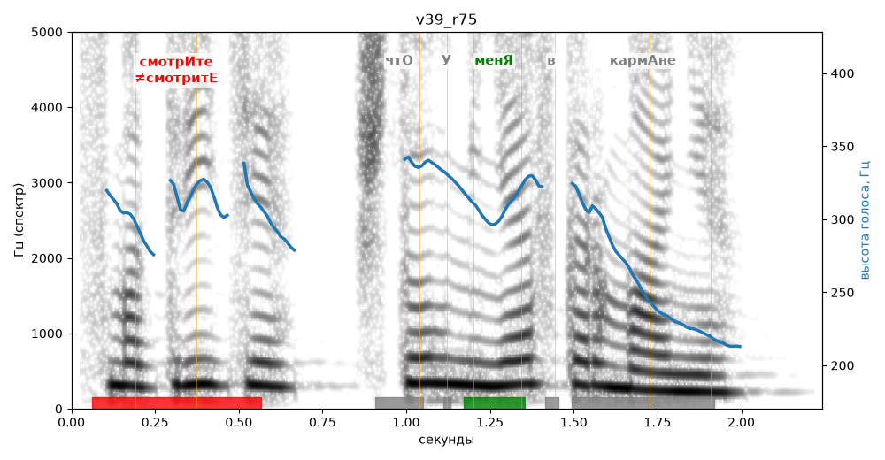

# v39_r75

Естественность (UTMOS): **2.41 из 5** (живой диктор ≈ 4–4.5)
Эталон: Смотрите, что у меня в кармане!
Распознано: Смотрите, что у меня в кармане.
Слова: все совпали

## Ударения
(где нужно: ruaccent)

| слово | нужно | у голоса | |
|---|---|---|---|
| смотрите | смотрИте | смотритЕ | ✗ ОШИБКА |
| меня | менЯ | менЯ | ✓ |
| кармане | кармАне | карманЕ | ? не разобрать |

## Интонация
- ✗ «смотрите что у меня в кармане!» — восклицание звучит ровно, без эмоции
- Диапазон голоса 7.6 полутонов (живо), средняя высота 305 Гц

## Паузы и темп
- паузы на своих местах
- Темп 7.3 слога/с (быстро)

_Синяя линия — высота голоса. Над словами заглавная буква — где ударение должно быть; красным — голос поставил не туда (уверенно), оранжевым — возможно._
