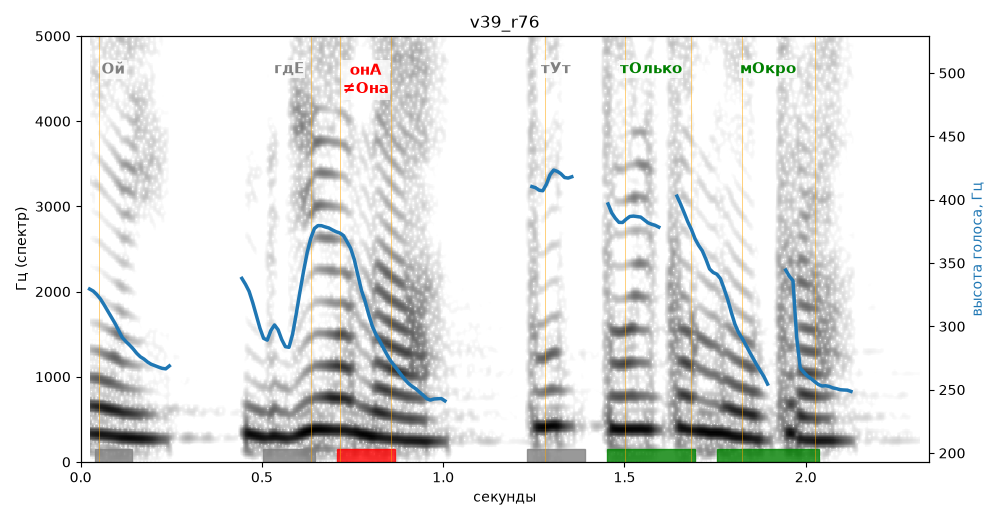

# v39_r76

Естественность (UTMOS): **2.14 из 5** (живой диктор ≈ 4–4.5)
Эталон: Ой! Где она? Тут только мокро!
Распознано: Ой, где она? Тут только мокра.
Расхождения в словах: «мокро» → «мокра»

## Ударения
(где нужно: ruaccent)

| слово | нужно | у голоса | |
|---|---|---|---|
| она | онА | Она | ✗ ОШИБКА |
| только | тОлько | тОлько | ✓ |
| мокро | мОкро | мОкро | ✓ |

## Интонация
- ✓ «где она?» — конец фразы понижается — звучит законченно
- ✓ «тут только мокро!» — выделено слово «тут» (+2.0 пт)
- Диапазон голоса 8.7 полутонов (живо), средняя высота 310 Гц

## Паузы и темп
- паузы на своих местах
- Темп 7.1 слога/с (быстро)

_Синяя линия — высота голоса. Над словами заглавная буква — где ударение должно быть; красным — голос поставил не туда (уверенно), оранжевым — возможно._
