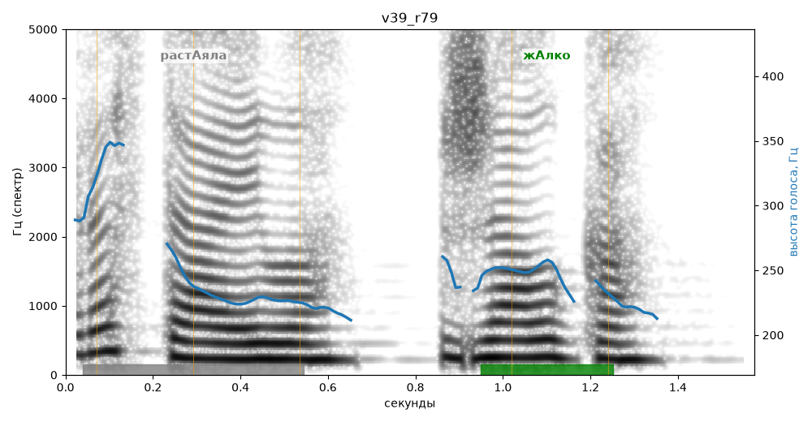

# v39_r79

Естественность (UTMOS): **2.28 из 5** (живой диктор ≈ 4–4.5)
Эталон: Растаяла. Жалко.
Распознано: Растаяла, жалко.
Слова: все совпали

## Ударения
(где нужно: ruaccent)

| слово | нужно | у голоса | |
|---|---|---|---|
| растаяла | растАяла | — | ? |
| жалко | жАлко | жАлко | ✓ |

## Интонация
- ✗ «растаяла.» — конец фразы не понижается — звучит незаконченно / как перечисление
- Диапазон голоса 7.6 полутонов (живо), средняя высота 234 Гц

## Паузы и темп
- паузы на своих местах
- Темп 6.2 слога/с (нормально)

_Синяя линия — высота голоса. Над словами заглавная буква — где ударение должно быть; красным — голос поставил не туда (уверенно), оранжевым — возможно._
