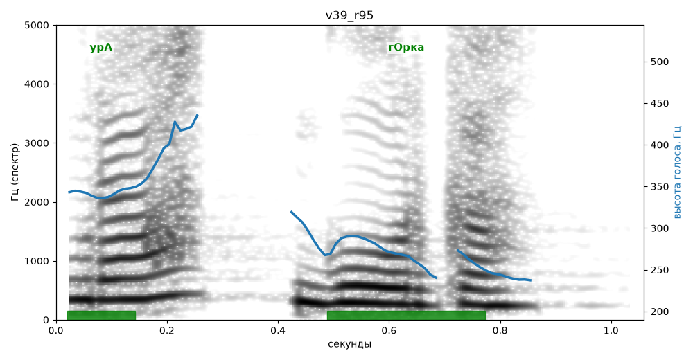

# v39_r95

Естественность (UTMOS): **1.84 из 5** (живой диктор ≈ 4–4.5)
Эталон: Ура, горка!
Распознано: Ура, горка.
Слова: все совпали

## Ударения
(где нужно: ruaccent)

| слово | нужно | у голоса | |
|---|---|---|---|
| ура | урА | урА | ✓ |
| горка | гОрка | гОрка | ✓ |

## Интонация
- ✓ «ура горка!» — выделено слово «ура» (+2.6 пт)
- Диапазон голоса 9.7 полутонов (живо), средняя высота 288 Гц

## Паузы и темп
- паузы на своих местах
- Темп 9.8 слога/с (быстро)

_Синяя линия — высота голоса. Над словами заглавная буква — где ударение должно быть; красным — голос поставил не туда (уверенно), оранжевым — возможно._
