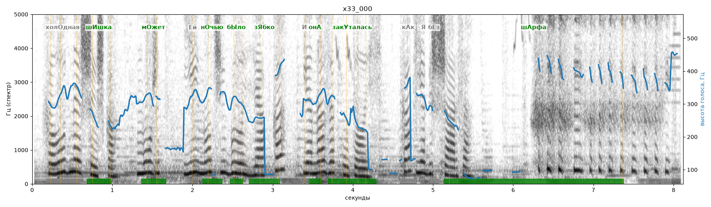

# x33_000

Голос: **Серия 33e, Рон, голос iPhone, «ши|шка»** · длительность 8.1 с
Естественность (UTMOS): **1.25 из 5** (живой диктор ≈ 4–4.5)
Эталон: Холодная шишка! Может, ей ночью было зябко? И она закуталась. Как я без шарфа.
Распознано: Холодная шишка. Может, ей ночью было зятка, и она закруталась. Как я без шарфа.
Расхождения в словах: «зябко» → «зятка»; «закуталась» → «закруталась»

## Ударения
(где нужно: ruaccent)

| слово | нужно | у голоса | |
|---|---|---|---|
| холодная | холОдная | — | ? |
| шишка | шИшка | шИшка | ✓ |
| может | мОжет | мОжет | ✓ |
| ночью | нОчью | нОчью | ✓ |
| было | бЫло | бЫло | ✓ |
| зябко | зЯбко | зЯбко | ✓ |
| она | онА | онА | ✓ |
| закуталась | закУталась | закУталась | ✓ |
| шарфа | шАрфа | шАрфа | ✓ |

## Интонация
- ✓ «холодная шишка!» — выделено слово «холодная» (+2.0 пт)
- ✗ «может ей ночью было зябко?» — нет вопросительного подъёма (самое высокое место — «ей», в начале) — звучит как утверждение
- ✓ «и она закуталась.» — конец фразы понижается — звучит законченно
- ✓ «как я без шарфа.» — конец фразы понижается — звучит законченно
- Диапазон голоса 27.0 полутонов (живо), средняя высота 300 Гц

## Паузы и темп
- паузы на своих местах
- Темп 4.0 слога/с (нормально)

_Синяя линия — высота голоса. Над словами заглавная буква — где ударение должно быть; красным — голос поставил не туда (уверенно), оранжевым — возможно._
