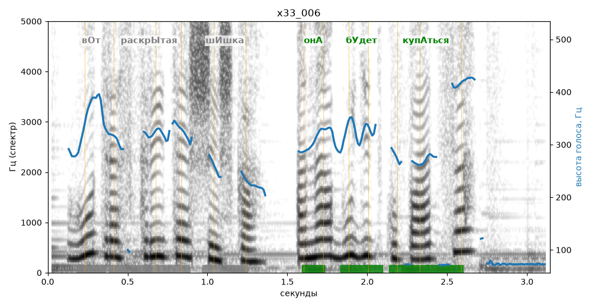

# x33_006

Голос: **Серия 33e, Рон, голос iPhone, «ши|шка»** · длительность 3.1 с
Естественность (UTMOS): **2.13 из 5** (живой диктор ≈ 4–4.5)
Эталон: Вот раскрытая шишка. Она будет купаться?
Распознано: Вот раскрытая шишка. Она будет купаться?
Слова: все совпали

## Ударения
(где нужно: ruaccent)

| слово | нужно | у голоса | |
|---|---|---|---|
| раскрытая | раскрЫтая | — | ? |
| шишка | шИшка | шишкА | ? не разобрать |
| она | онА | онА | ✓ |
| будет | бУдет | бУдет | ✓ |
| купаться | купАться | купАться | ✓ |

## Интонация
- ✓ «вот раскрытая шишка.» — конец фразы понижается — звучит законченно
- ✗ «она будет купаться?» — нет вопросительного подъёма (самое высокое место — «она», в начале) — звучит как утверждение
- Диапазон голоса 30.1 полутонов (живо), средняя высота 291 Гц

## Паузы и темп
- паузы на своих местах
- Темп 6.3 слога/с (нормально)

_Синяя линия — высота голоса. Над словами заглавная буква — где ударение должно быть; красным — голос поставил не туда (уверенно), оранжевым — возможно._
