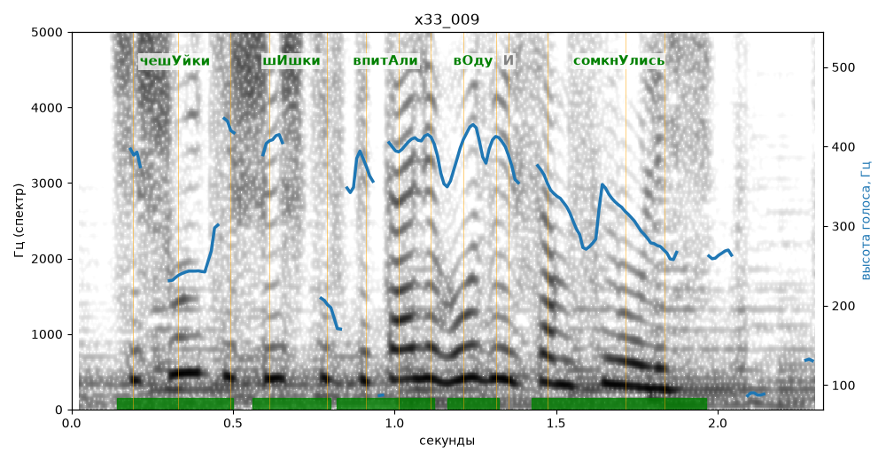

# x33_009

Голос: **Серия 33e, Пик, голос iPhone, «ши|шка»** · длительность 2.3 с
Естественность (UTMOS): **1.32 из 5** (живой диктор ≈ 4–4.5)
Эталон: Чешуйки шишки впитали воду и сомкнулись.
Распознано: Чешуйки, шишки впитали водой и сам снулись.
Расхождения в словах: «воду» → «водой»; «сомкнулись» → «сам снулись»

## Ударения
(где нужно: ruaccent)

| слово | нужно | у голоса | |
|---|---|---|---|
| чешуйки | чешУйки | чешУйки | ✓ |
| шишки | шИшки | шИшки | ✓ |
| впитали | впитАли | впитАли | ✓ |
| воду | вОду | вОду | ✓ |
| сомкнулись | сомкнУлись | сомкнУлись | ✓ |

## Интонация
- ✓ «чешуйки шишки впитали воду и сомкнулись.» — конец фразы понижается — звучит законченно
- Диапазон голоса 23.2 полутонов (живо), средняя высота 335 Гц

## Паузы и темп
- паузы на своих местах
- Темп 7.7 слога/с (быстро)

_Синяя линия — высота голоса. Над словами заглавная буква — где ударение должно быть; красным — голос поставил не туда (уверенно), оранжевым — возможно._
