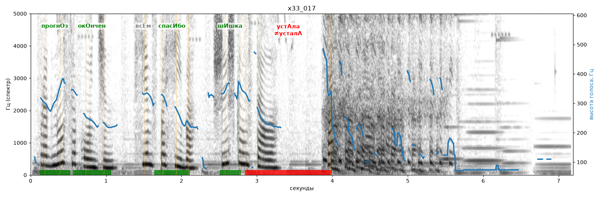

# x33_017

Голос: **Серия 33e, Рон, голос iPhone, «ши|шка»** · длительность 7.2 с
Естественность (UTMOS): **1.33 из 5** (живой диктор ≈ 4–4.5)
Эталон: Прогноз окончен. Всем спасибо. Шишка устала.
Распознано: Прогноз окончен. Всем спасибо. Шишка устала.
Слова: все совпали

## Ударения
(где нужно: ruaccent)

| слово | нужно | у голоса | |
|---|---|---|---|
| прогноз | прогнОз | прогнОз | ✓ |
| окончен | окОнчен | окОнчен | ✓ |
| спасибо | спасИбо | спасИбо | ✓ |
| шишка | шИшка | шИшка | ✓ |
| устала | устАла | усталА | ✗ ОШИБКА |

## Интонация
- ✓ «прогноз окончен.» — конец фразы понижается — звучит законченно
- ✓ «всем спасибо.» — конец фразы понижается — звучит законченно
- ✓ «шишка устала.» — конец фразы понижается — звучит законченно
- Диапазон голоса 28.4 полутонов (живо), средняя высота 221 Гц

## Паузы и темп
- паузы на своих местах
- Темп 4.5 слога/с (нормально)

_Синяя линия — высота голоса. Над словами заглавная буква — где ударение должно быть; красным — голос поставил не туда (уверенно), оранжевым — возможно._
