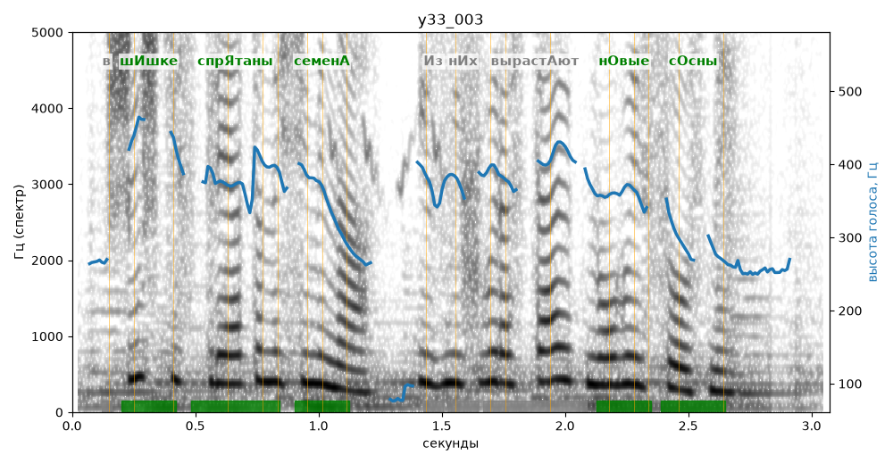

# y33_003

Голос: **Серия 33f, Пик, голос iPhone** · длительность 3.1 с
Естественность (UTMOS): **1.29 из 5** (живой диктор ≈ 4–4.5)
Эталон: В шишке спрятаны семена. Из них вырастают новые сосны.
Распознано: В шишке спрятаны семена, из них вырастают новые сосны.
Слова: все совпали

## Ударения
(где нужно: ruaccent)

| слово | нужно | у голоса | |
|---|---|---|---|
| шишке | шИшке | шИшке | ✓ |
| спрятаны | спрЯтаны | спрЯтаны | ✓ |
| семена | семенА | семенА | ✓ |
| вырастают | вырастАют | — | ? |
| новые | нОвые | нОвые | ✓ |
| сосны | сОсны | сОсны | ✓ |

## Интонация
- ✓ «в шишке спрятаны семена.» — конец фразы понижается — звучит законченно
- ✓ «из них вырастают новые сосны.» — конец фразы понижается — звучит законченно
- Диапазон голоса 9.2 полутонов (живо), средняя высота 363 Гц

## Паузы и темп
- паузы на своих местах
- Темп 8.5 слога/с (быстро)

_Синяя линия — высота голоса. Над словами заглавная буква — где ударение должно быть; красным — голос поставил не туда (уверенно), оранжевым — возможно._
