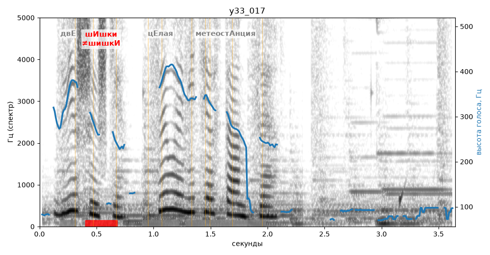

# y33_017

Голос: **Серия 33f, Рон, голос iPhone** · длительность 3.6 с
Естественность (UTMOS): **1.39 из 5** (живой диктор ≈ 4–4.5)
Эталон: Две шишки! Целая метеостанция!
Распознано: Две шишки, целая медсестанция.
Расхождения в словах: «метеостанция» → «медсестанция»

## Ударения
(где нужно: ruaccent)

| слово | нужно | у голоса | |
|---|---|---|---|
| шишки | шИшки | шишкИ | ✗ ОШИБКА |
| целая | цЕлая | — | ? |
| метеостанция | метеостАнция | — | ? |

## Интонация
- ✓ «две шишки!» — выделено слово «две» (+5.1 пт)
- ✗ «целая метеостанция!» — восклицание звучит ровно, без эмоции
- Диапазон голоса 29.2 полутонов (живо), средняя высота 229 Гц

## Паузы и темп
- паузы на своих местах
- Темп 6.3 слога/с (нормально)

_Синяя линия — высота голоса. Над словами заглавная буква — где ударение должно быть; красным — голос поставил не туда (уверенно), оранжевым — возможно._
