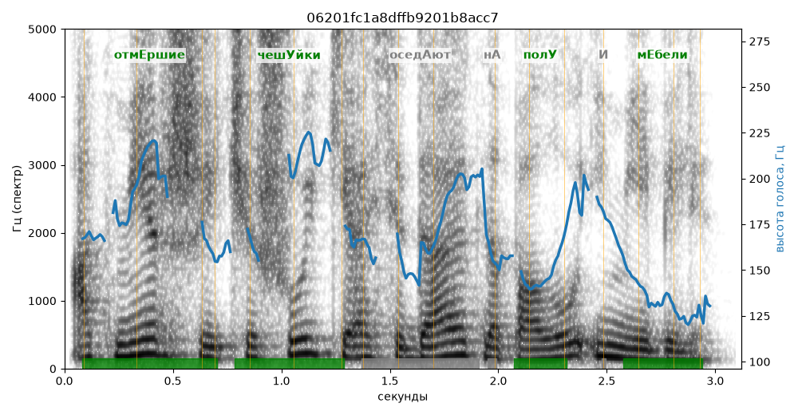

# 06201fc1a8dffb9201b8acc7

Естественность (UTMOS): **3.22 из 5** (живой диктор ≈ 4–4.5)
Эталон: Отм+ершие чеш+уйки осед+ают на пол+у и м+ебели.
Распознано: Отмершие чешуйки оседают на полу и мебели.
Слова: все совпали

## Ударения
(где нужно: дано в тексте)

| слово | нужно | у голоса | |
|---|---|---|---|
| отмершие | отмЕршие | отмЕршие | ✓ |
| чешуйки | чешУйки | чешУйки | ✓ |
| оседают | оседАют | — | ? |
| полу | полУ | полУ | ✓ |
| мебели | мЕбели | мЕбели | ✓ |

## Интонация
- ✓ «отмершие чешуйки оседают на полу и мебели.» — конец фразы понижается — звучит законченно
- Диапазон голоса 9.4 полутонов (живо), средняя высота 166 Гц

## Паузы и темп
- паузы на своих местах
- Темп 6.3 слога/с (нормально)

_Синяя линия — высота голоса. Над словами заглавная буква — где ударение должно быть; красным — голос поставил не туда (уверенно), оранжевым — возможно._
