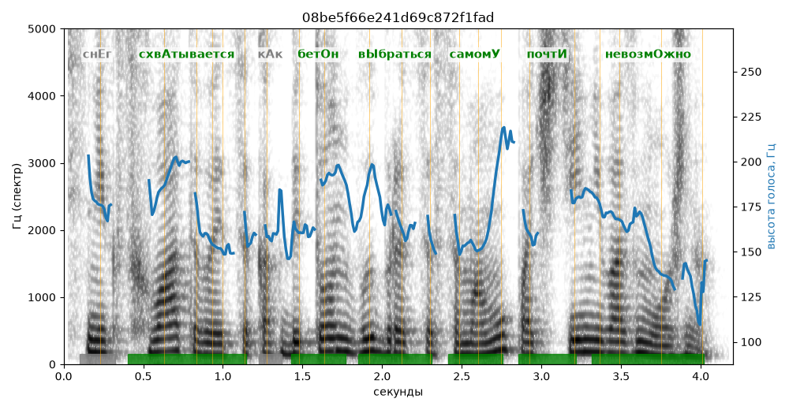

# 08be5f66e241d69c872f1fad

Естественность (UTMOS): **3.26 из 5** (живой диктор ≈ 4–4.5)
Эталон: Снег схв+атывается как бет+он — в+ыбраться самом+у почт+и невозм+ожно.
Распознано: Снег схватывается, как бетон выбраться самому почти невозможно.
Слова: все совпали

## Ударения
(где нужно: дано в тексте)

| слово | нужно | у голоса | |
|---|---|---|---|
| схватывается | схвАтывается | схвАтывается | ✓ |
| бетон | бетОн | бетОн | ✓ |
| выбраться | вЫбраться | вЫбраться | ✓ |
| самому | самомУ | самомУ | ✓ |
| почти | почтИ | почтИ | ✓ |
| невозможно | невозмОжно | невозмОжно | ✓ |

## Интонация
- ✓ «снег схватывается как бетон выбраться самому почти невозможно.» — конец фразы понижается — звучит законченно
- Диапазон голоса 6.6 полутонов (нормально), средняя высота 167 Гц

## Паузы и темп
- паузы на своих местах
- Темп 5.4 слога/с (нормально)

_Синяя линия — высота голоса. Над словами заглавная буква — где ударение должно быть; красным — голос поставил не туда (уверенно), оранжевым — возможно._
