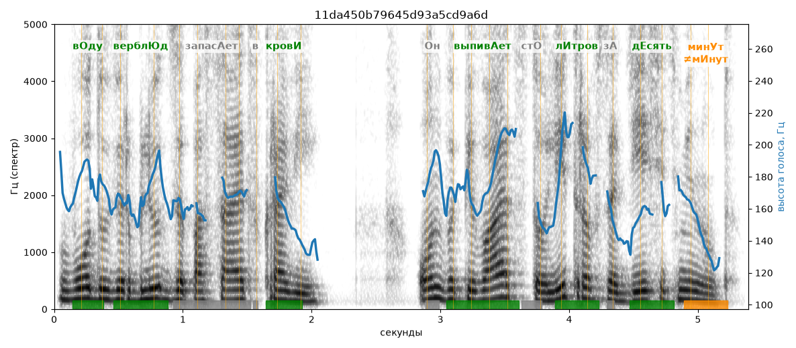

# 11da450b79645d93a5cd9a6d

Естественность (UTMOS): **3.38 из 5** (живой диктор ≈ 4–4.5)
Эталон: В+оду вербл+юд запас+ает в кров+и: +он выпив+ает ст+о л+итров за д+есять мин+ут.
Распознано: Воду верблюд запасает в крови. Он выпивает 100 литров за 10 минут.
Расхождения в словах: «сто» → «100»; «десять» → «10»

## Ударения
(где нужно: дано в тексте)

| слово | нужно | у голоса | |
|---|---|---|---|
| воду | вОду | вОду | ✓ |
| верблюд | верблЮд | верблЮд | ✓ |
| запасает | запасАет | запасаЕт | ? не разобрать |
| крови | кровИ | кровИ | ✓ |
| выпивает | выпивАет | выпивАет | ✓ |
| литров | лИтров | лИтров | ✓ |
| десять | дЕсять | дЕсять | ✓ |
| минут | минУт | мИнут | ✗? возможно — послушать |

## Интонация
- ✓ «воду верблюд запасает в крови он выпивает сто литров за десять минут.» — конец фразы понижается — звучит законченно
- Диапазон голоса 7.4 полутонов (живо), средняя высота 165 Гц

## Паузы и темп
- паузы на своих местах
- Темп 5.8 слога/с (нормально)

_Синяя линия — высота голоса. Над словами заглавная буква — где ударение должно быть; красным — голос поставил не туда (уверенно), оранжевым — возможно._
