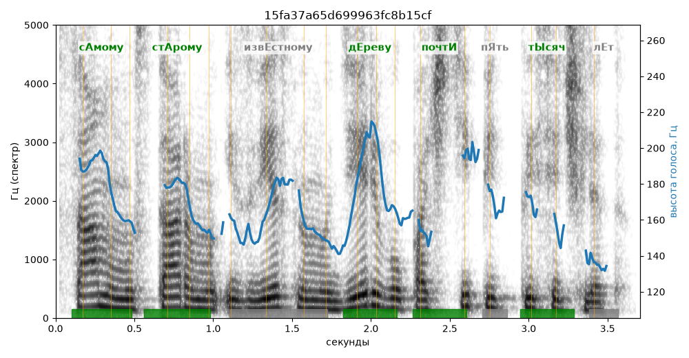

# 15fa37a65d699963fc8b15cf

Естественность (UTMOS): **2.99 из 5** (живой диктор ≈ 4–4.5)
Эталон: С+амому ст+арому изв+естному д+ереву почт+и пять т+ысяч лет.

## Ударения
(где нужно: дано в тексте)

| слово | нужно | у голоса | |
|---|---|---|---|
| самому | сАмому | сАмому | ✓ |
| старому | стАрому | стАрому | ✓ |
| известному | извЕстному | известнОму | ? не разобрать |
| дереву | дЕреву | дЕреву | ✓ |
| почти | почтИ | почтИ | ✓ |
| тысяч | тЫсяч | тЫсяч | ✓ |

## Интонация
- ✓ «самому старому известному дереву почти пять тысяч лет.» — конец фразы понижается — звучит законченно
- Диапазон голоса 6.0 полутонов (нормально), средняя высота 163 Гц

## Паузы и темп
- паузы на своих местах
- Темп 5.5 слога/с (нормально)

_Синяя линия — высота голоса. Над словами заглавная буква — где ударение должно быть; красным — голос поставил не туда (уверенно), оранжевым — возможно._
