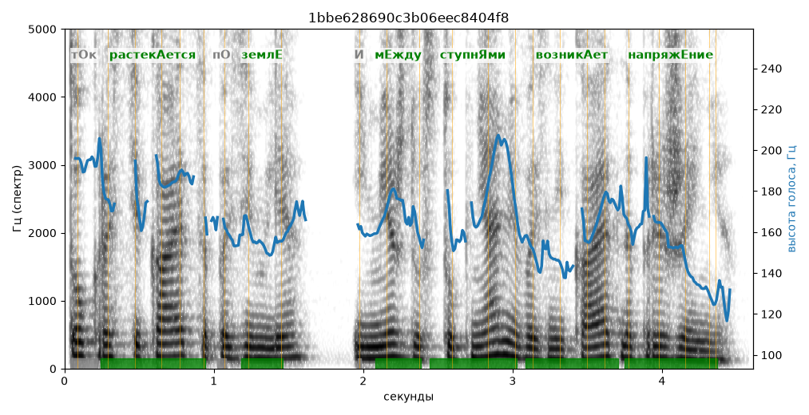

# 1bbe628690c3b06eec8404f8

Естественность (UTMOS): **3.46 из 5** (живой диктор ≈ 4–4.5)
Эталон: Т+ок растек+ается по земл+е, и м+ежду ступн+ями возник+ает напряж+ение.
Распознано: Ток растекается по земле, и между ступнями возникает напряжение.
Слова: все совпали

## Ударения
(где нужно: дано в тексте)

| слово | нужно | у голоса | |
|---|---|---|---|
| растекается | растекАется | растекАется | ✓ |
| земле | землЕ | землЕ | ✓ |
| между | мЕжду | мЕжду | ✓ |
| ступнями | ступнЯми | ступнЯми | ✓ |
| возникает | возникАет | возникАет | ✓ |
| напряжение | напряжЕние | напряжЕние | ✓ |

## Интонация
- ✓ «ток растекается по земле и между ступнями возникает напряжение.» — конец фразы понижается — звучит законченно
- Диапазон голоса 6.7 полутонов (нормально), средняя высота 163 Гц

## Паузы и темп
- паузы на своих местах
- Темп 6.3 слога/с (нормально)

_Синяя линия — высота голоса. Над словами заглавная буква — где ударение должно быть; красным — голос поставил не туда (уверенно), оранжевым — возможно._
