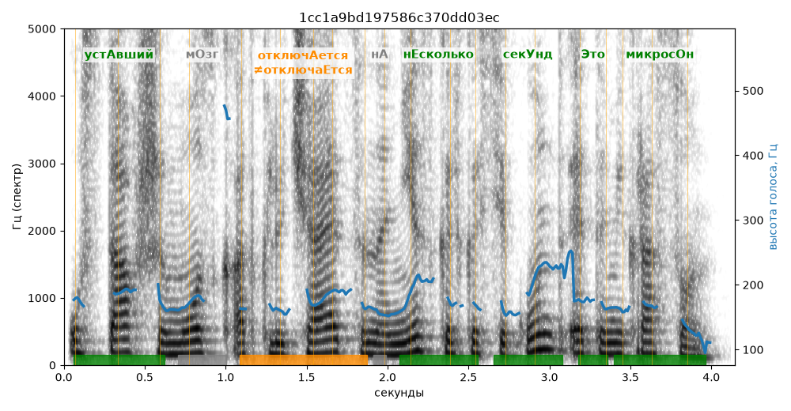

# 1cc1a9bd197586c370dd03ec

Естественность (UTMOS): **3.54 из 5** (живой диктор ≈ 4–4.5)
Эталон: Уст+авший м+озг отключ+ается на н+есколько сек+унд — +это микрос+он.
Распознано: Уставший мозг отключается на несколько секунд. Это микросон.
Слова: все совпали

## Ударения
(где нужно: дано в тексте)

| слово | нужно | у голоса | |
|---|---|---|---|
| уставший | устАвший | устАвший | ✓ |
| отключается | отключАется | отключаЕтся | ✗? возможно — послушать |
| несколько | нЕсколько | нЕсколько | ✓ |
| секунд | секУнд | секУнд | ✓ |
| это | Это | Это | ✓ |
| микросон | микросОн | микросОн | ✓ |

## Интонация
- ✓ «уставший мозг отключается на несколько секунд это микросон.» — конец фразы понижается — звучит законченно
- Диапазон голоса 9.9 полутонов (живо), средняя высота 170 Гц

## Паузы и темп
- паузы на своих местах
- Темп 5.1 слога/с (нормально)

_Синяя линия — высота голоса. Над словами заглавная буква — где ударение должно быть; красным — голос поставил не туда (уверенно), оранжевым — возможно._
