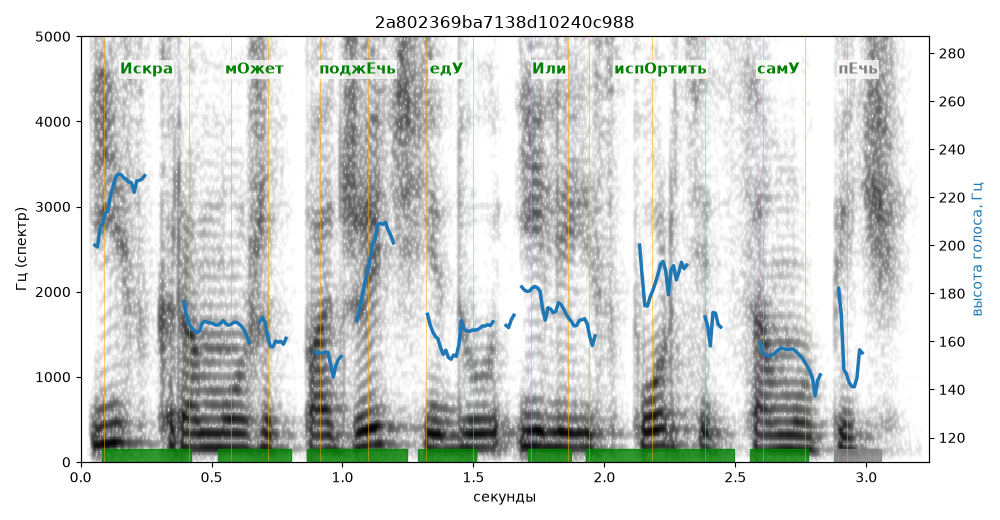

# 2a802369ba7138d10240c988

Естественность (UTMOS): **3.46 из 5** (живой диктор ≈ 4–4.5)
Эталон: +Искра м+ожет подж+ечь ед+у +или исп+ортить сам+у печь.
Распознано: Искра может поджечь еду или испортить саму печь.
Слова: все совпали

## Ударения
(где нужно: дано в тексте)

| слово | нужно | у голоса | |
|---|---|---|---|
| искра | Искра | Искра | ✓ |
| может | мОжет | мОжет | ✓ |
| поджечь | поджЕчь | поджЕчь | ✓ |
| еду | едУ | едУ | ✓ |
| или | Или | Или | ✓ |
| испортить | испОртить | испОртить | ✓ |
| саму | самУ | самУ | ✓ |

## Интонация
- ✓ «искра может поджечь еду или испортить саму печь.» — конец фразы понижается — звучит законченно
- Диапазон голоса 7.4 полутонов (живо), средняя высота 167 Гц

## Паузы и темп
- паузы на своих местах
- Темп 5.8 слога/с (нормально)

_Синяя линия — высота голоса. Над словами заглавная буква — где ударение должно быть; красным — голос поставил не туда (уверенно), оранжевым — возможно._
