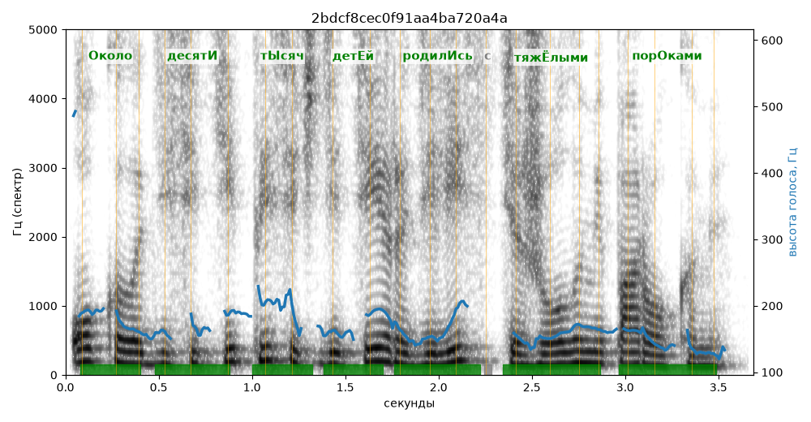

# 2bdcf8cec0f91aa4ba720a4a

Естественность (UTMOS): **3.01 из 5** (живой диктор ≈ 4–4.5)
Эталон: +Около десят+и т+ысяч дет+ей родил+ись с тяж+ёлыми пор+оками.
Распознано: около 10 тысяч детей родились с тяжелыми пороками.
Расхождения в словах: «десяти» → «10»

## Ударения
(где нужно: дано в тексте)

| слово | нужно | у голоса | |
|---|---|---|---|
| около | Около | Около | ✓ |
| десяти | десятИ | десятИ | ✓ |
| тысяч | тЫсяч | тЫсяч | ✓ |
| детей | детЕй | детЕй | ✓ |
| родились | родилИсь | родилИсь | ✓ |
| тяжёлыми | тяжЁлыми | тяжЁлыми | ✓ |
| пороками | порОками | порОками | ✓ |

## Интонация
- ✓ «около десяти тысяч детей родились с тяжёлыми пороками.» — конец фразы понижается — звучит законченно
- Диапазон голоса 7.8 полутонов (живо), средняя высота 163 Гц

## Паузы и темп
- паузы на своих местах
- Темп 6.5 слога/с (нормально)

_Синяя линия — высота голоса. Над словами заглавная буква — где ударение должно быть; красным — голос поставил не туда (уверенно), оранжевым — возможно._
