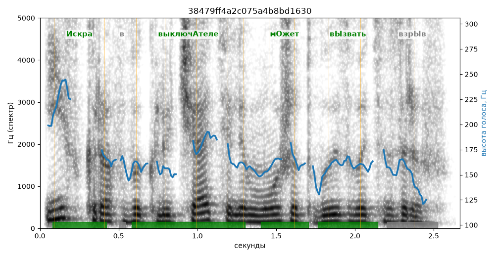

# 38479ff4a2c075a4b8bd1630

Естественность (UTMOS): **3.37 из 5** (живой диктор ≈ 4–4.5)
Эталон: +Искра в выключ+ателе м+ожет в+ызвать взрыв.
Распознано: искров в выключателе может вызвать взрыв.
Расхождения в словах: «искра» → «искров»

## Ударения
(где нужно: дано в тексте)

| слово | нужно | у голоса | |
|---|---|---|---|
| искра | Искра | Искра | ✓ |
| выключателе | выключАтеле | выключАтеле | ✓ |
| может | мОжет | мОжет | ✓ |
| вызвать | вЫзвать | вЫзвать | ✓ |

## Интонация
- ✓ «искра в выключателе может вызвать взрыв.» — конец фразы понижается — звучит законченно
- Диапазон голоса 7.9 полутонов (живо), средняя высота 160 Гц

## Паузы и темп
- паузы на своих местах
- Темп 5.3 слога/с (нормально)

_Синяя линия — высота голоса. Над словами заглавная буква — где ударение должно быть; красным — голос поставил не туда (уверенно), оранжевым — возможно._
