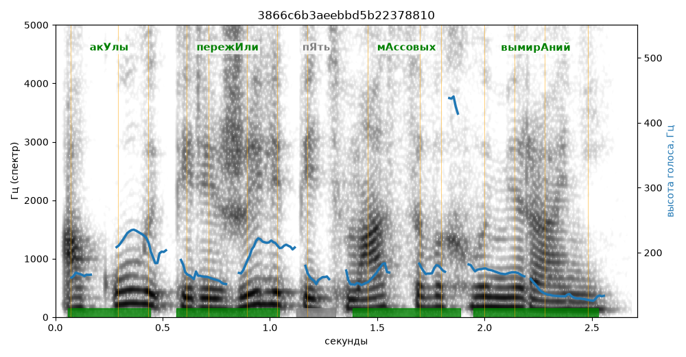

# 3866c6b3aeebbd5b22378810

Естественность (UTMOS): **3.29 из 5** (живой диктор ≈ 4–4.5)
Эталон: Ак+улы переж+или пять м+ассовых вымир+аний.
Распознано: Акулы пережили петь массовых вымираний.
Расхождения в словах: «пять» → «петь»

## Ударения
(где нужно: дано в тексте)

| слово | нужно | у голоса | |
|---|---|---|---|
| акулы | акУлы | акУлы | ✓ |
| пережили | пережИли | пережИли | ✓ |
| массовых | мАссовых | мАссовых | ✓ |
| вымираний | вымирАний | вымирАний | ✓ |

## Интонация
- ✓ «акулы пережили пять массовых вымираний.» — конец фразы понижается — звучит законченно
- Диапазон голоса 9.8 полутонов (живо), средняя высота 168 Гц

## Паузы и темп
- паузы на своих местах
- Темп 6.1 слога/с (нормально)

_Синяя линия — высота голоса. Над словами заглавная буква — где ударение должно быть; красным — голос поставил не туда (уверенно), оранжевым — возможно._
