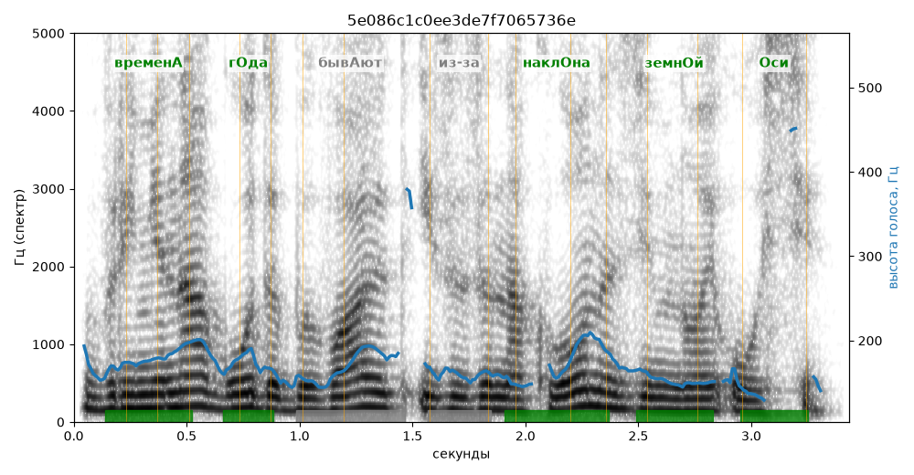

# 5e086c1c0ee3de7f7065736e

Естественность (UTMOS): **2.88 из 5** (живой диктор ≈ 4–4.5)
Эталон: Времен+а г+ода быв+ают из-за накл+она земн+ой +оси.

## Ударения
(где нужно: ruaccent)

| слово | нужно | у голоса | |
|---|---|---|---|
| времена | временА | временА | ✓ |
| года | гОда | гОда | ✓ |
| бывают | бывАют | — | ? |
| из-за | из-за | Из-за | нет эталона |
| наклона | наклОна | наклОна | ✓ |
| земной | земнОй | земнОй | ✓ |
| оси | Оси | Оси | ✓ |

## Интонация
- ✓ «времена года бывают из-за наклона земной оси.» — конец фразы понижается — звучит законченно
- Диапазон голоса 5.7 полутонов (нормально), средняя высота 164 Гц

## Паузы и темп
- паузы на своих местах
- Темп 5.1 слога/с (нормально)

_Синяя линия — высота голоса. Над словами заглавная буква — где ударение должно быть; красным — голос поставил не туда (уверенно), оранжевым — возможно._
