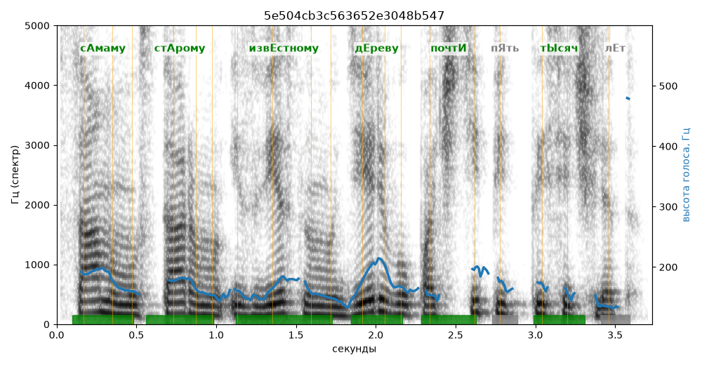

# 5e504cb3c563652e3048b547

Естественность (UTMOS): **3.35 из 5** (живой диктор ≈ 4–4.5)
Эталон: С+амаму ст+арому изв+естному д+ереву почт+и пять т+ысяч лет.
Распознано: самому старому известному дереву почти 5000 лет.
Расхождения в словах: «самаму» → «самому»; «пять тысяч» → «5000»

## Ударения
(где нужно: дано в тексте)

| слово | нужно | у голоса | |
|---|---|---|---|
| самаму | сАмаму | сАмаму | ✓ |
| старому | стАрому | стАрому | ✓ |
| известному | извЕстному | извЕстному | ✓ |
| дереву | дЕреву | дЕреву | ✓ |
| почти | почтИ | почтИ | ✓ |
| тысяч | тЫсяч | тЫсяч | ✓ |

## Интонация
- ✓ «самаму старому известному дереву почти пять тысяч лет.» — конец фразы понижается — звучит законченно
- Диапазон голоса 6.7 полутонов (нормально), средняя высота 162 Гц

## Паузы и темп
- паузы на своих местах
- Темп 5.4 слога/с (нормально)

_Синяя линия — высота голоса. Над словами заглавная буква — где ударение должно быть; красным — голос поставил не туда (уверенно), оранжевым — возможно._
