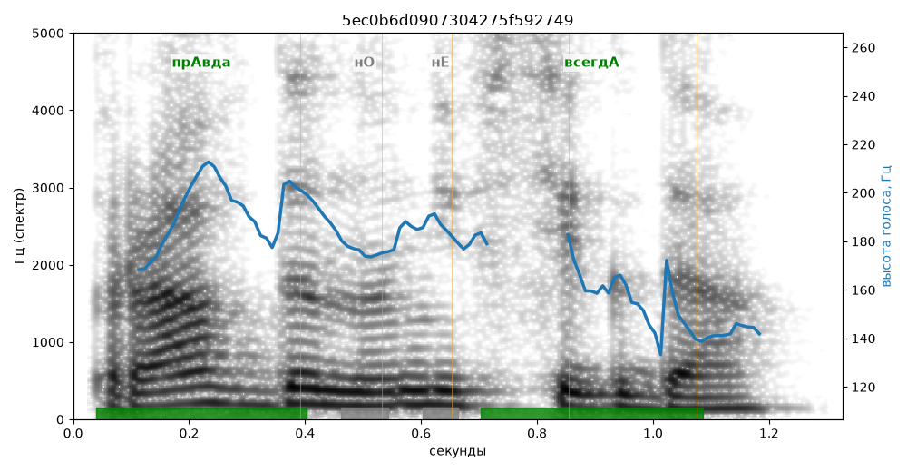

# 5ec0b6d0907304275f592749

Естественность (UTMOS): **2.56 из 5** (живой диктор ≈ 4–4.5)
Эталон: Пр+авда — н+о не всегд+а.
Распознано: Правда, но не всегда.
Слова: все совпали

## Ударения
(где нужно: дано в тексте)

| слово | нужно | у голоса | |
|---|---|---|---|
| правда | прАвда | прАвда | ✓ |
| всегда | всегдА | всегдА | ✓ |

## Интонация
- ✓ «правда но не всегда.» — конец фразы понижается — звучит законченно
- Диапазон голоса 6.5 полутонов (нормально), средняя высота 178 Гц

## Паузы и темп
- паузы на своих местах
- Темп 5.7 слога/с (нормально)

_Синяя линия — высота голоса. Над словами заглавная буква — где ударение должно быть; красным — голос поставил не туда (уверенно), оранжевым — возможно._
