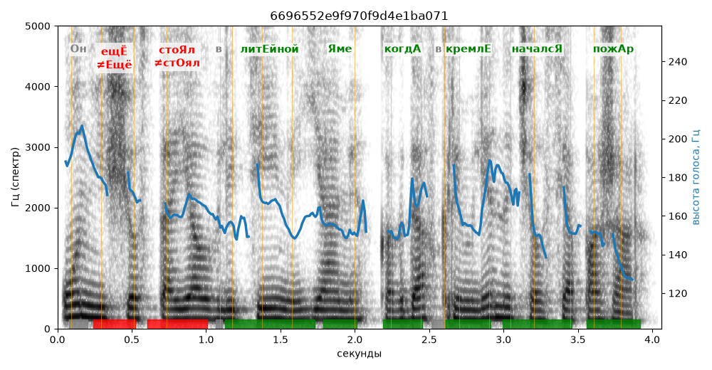

# 6696552e9f970f9d4e1ba071

Естественность (UTMOS): **3.11 из 5** (живой диктор ≈ 4–4.5)
Эталон: +Он ещ+ё сто+ял в лит+ейной +яме, когд+а в Кремл+е началс+я пож+ар.
Распознано: Он еще стоял в литейной яме, когда в Кремле начался пожар.
Слова: все совпали

## Ударения
(где нужно: дано в тексте)

| слово | нужно | у голоса | |
|---|---|---|---|
| ещё | ещЁ | Ещё | ✗ ОШИБКА |
| стоял | стоЯл | стОял | ✗ ОШИБКА |
| литейной | литЕйной | литЕйной | ✓ |
| яме | Яме | Яме | ✓ |
| когда | когдА | когдА | ✓ |
| кремле | кремлЕ | кремлЕ | ✓ |
| начался | началсЯ | началсЯ | ✓ |
| пожар | пожАр | пожАр | ✓ |

## Интонация
- ✓ «он ещё стоял в литейной яме когда в кремле начался пожар.» — конец фразы понижается — звучит законченно
- Диапазон голоса 4.7 полутонов (нормально), средняя высота 160 Гц

## Паузы и темп
- паузы на своих местах
- Темп 5.2 слога/с (нормально)

_Синяя линия — высота голоса. Над словами заглавная буква — где ударение должно быть; красным — голос поставил не туда (уверенно), оранжевым — возможно._
