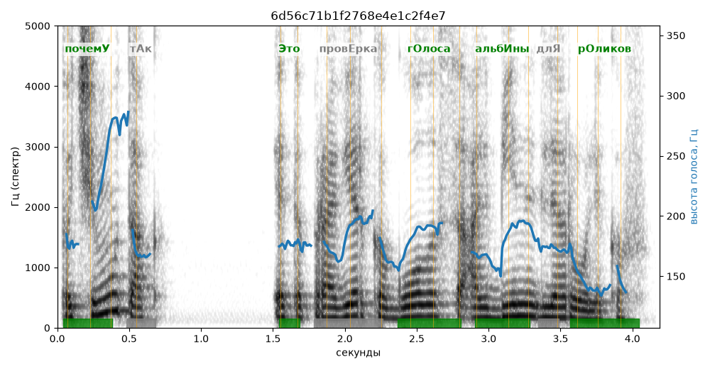

# 6d56c71b1f2768e4e1c2f4e7

Естественность (UTMOS): **3.18 из 5** (живой диктор ≈ 4–4.5)
Эталон: Почем+у так? +Это пров+ерка г+олоса Альб+ины для р+оликов.

## Ударения
(где нужно: дано в тексте)

| слово | нужно | у голоса | |
|---|---|---|---|
| почему | почемУ | почемУ | ✓ |
| это | Это | Это | ✓ |
| проверка | провЕрка | прОверка | ? не разобрать |
| голоса | гОлоса | гОлоса | ✓ |
| альбины | альбИны | альбИны | ✓ |
| роликов | рОликов | рОликов | ✓ |

## Интонация
- ✓ «почему так?» — конец фразы понижается — звучит законченно
- ✓ «это проверка голоса альбины для роликов.» — конец фразы понижается — звучит законченно
- Диапазон голоса 11.3 полутонов (живо), средняя высота 175 Гц

## Паузы и темп
- паузы на своих местах
- Темп 6.0 слога/с (нормально)

_Синяя линия — высота голоса. Над словами заглавная буква — где ударение должно быть; красным — голос поставил не туда (уверенно), оранжевым — возможно._
