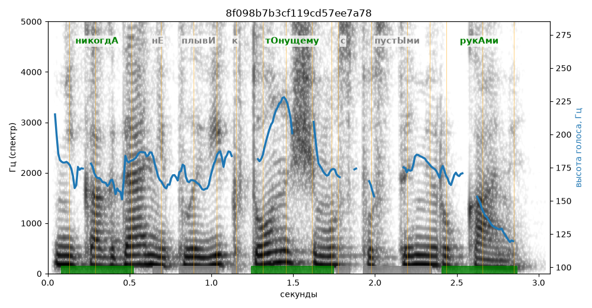

# 8f098b7b3cf119cd57ee7a78

Естественность (UTMOS): **2.64 из 5** (живой диктор ≈ 4–4.5)
Эталон: Никогд+а не плыв+и к т+онущему с пуст+ыми рук+ами.
Распознано: Никогда не плыви к тонущему с пустыми руками.
Слова: все совпали

## Ударения
(где нужно: дано в тексте)

| слово | нужно | у голоса | |
|---|---|---|---|
| никогда | никогдА | никогдА | ✓ |
| плыви | плывИ | плЫви | ? не разобрать |
| тонущему | тОнущему | тОнущему | ✓ |
| пустыми | пустЫми | пустымИ | ? не разобрать |
| руками | рукАми | рукАми | ✓ |

## Интонация
- ✓ «никогда не плыви к тонущему с пустыми руками.» — конец фразы понижается — звучит законченно
- Диапазон голоса 8.6 полутонов (живо), средняя высота 173 Гц

## Паузы и темп
- паузы на своих местах
- Темп 6.5 слога/с (нормально)

_Синяя линия — высота голоса. Над словами заглавная буква — где ударение должно быть; красным — голос поставил не туда (уверенно), оранжевым — возможно._
