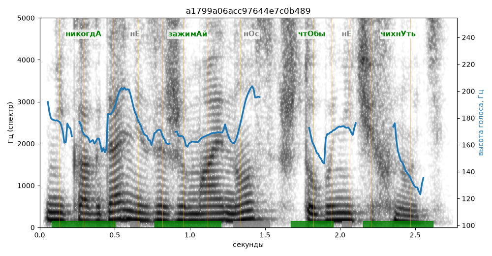

# a1799a06acc97644e7c0b489

Естественность (UTMOS): **3.12 из 5** (живой диктор ≈ 4–4.5)
Эталон: Никогд+а не зажим+ай н+ос, чт+обы не чихн+уть.
Распознано: Никогда не зажимай нос, чтобы не чихнуть.
Слова: все совпали

## Ударения
(где нужно: дано в тексте)

| слово | нужно | у голоса | |
|---|---|---|---|
| никогда | никогдА | никогдА | ✓ |
| зажимай | зажимАй | зажимАй | ✓ |
| чтобы | чтОбы | чтОбы | ✓ |
| чихнуть | чихнУть | чихнУть | ✓ |

## Интонация
- ✓ «никогда не зажимай нос чтобы не чихнуть.» — конец фразы понижается — звучит законченно
- Диапазон голоса 6.6 полутонов (нормально), средняя высота 168 Гц

## Паузы и темп
- паузы на своих местах
- Темп 5.1 слога/с (нормально)

_Синяя линия — высота голоса. Над словами заглавная буква — где ударение должно быть; красным — голос поставил не туда (уверенно), оранжевым — возможно._
