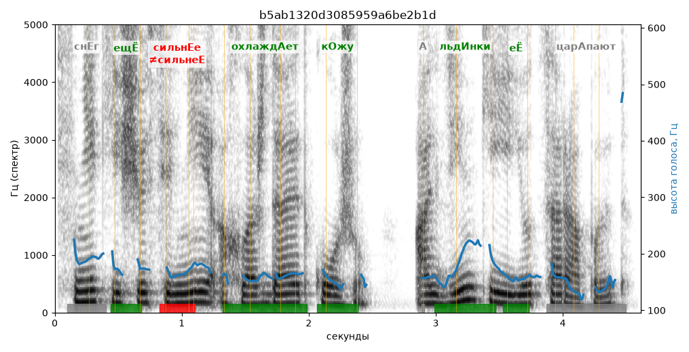

# b5ab1320d3085959a6be2b1d

Естественность (UTMOS): **3.4 из 5** (живой диктор ≈ 4–4.5)
Эталон: Сн+ег ещ+ё сильн+ее охлажд+ает к+ожу, а льд+инки е+ё цар+апают.
Распознано: Снег еще сильнее охлаждает кожу, а льдинки ее царапают.
Слова: все совпали

## Ударения
(где нужно: дано в тексте)

| слово | нужно | у голоса | |
|---|---|---|---|
| ещё | ещЁ | ещЁ | ✓ |
| сильнее | сильнЕе | сильнеЕ | ✗ ОШИБКА |
| охлаждает | охлаждАет | охлаждАет | ✓ |
| кожу | кОжу | кОжу | ✓ |
| льдинки | льдИнки | льдИнки | ✓ |
| её | еЁ | еЁ | ✓ |
| царапают | царАпают | — | ? |

## Интонация
- ✓ «снег ещё сильнее охлаждает кожу а льдинки её царапают.» — конец фразы понижается — звучит законченно
- Диапазон голоса 8.0 полутонов (живо), средняя высота 162 Гц

## Паузы и темп
- паузы на своих местах
- Темп 5.4 слога/с (нормально)

_Синяя линия — высота голоса. Над словами заглавная буква — где ударение должно быть; красным — голос поставил не туда (уверенно), оранжевым — возможно._
