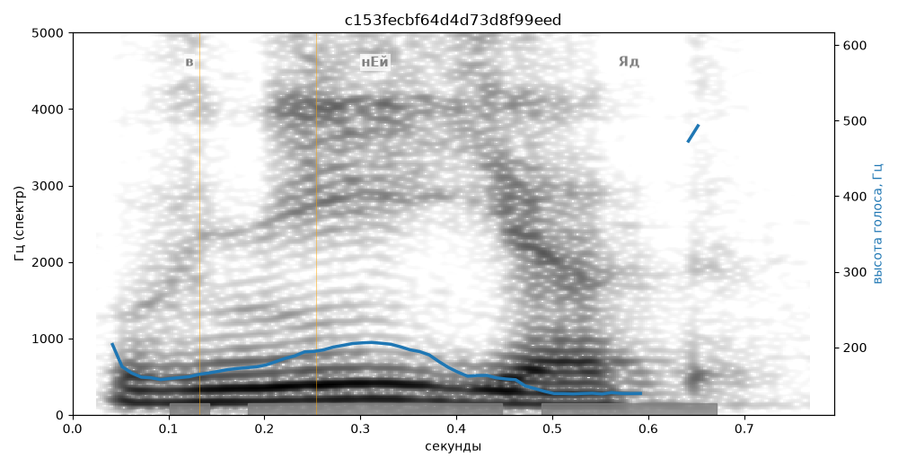

# c153fecbf64d4d73d8f99eed

Естественность (UTMOS): **3.39 из 5** (живой диктор ≈ 4–4.5)
Эталон: В н+ей +яд.
Распознано: В ней яд.
Слова: все совпали

## Ударения
(где нужно: дано в тексте)

| слово | нужно | у голоса | |
|---|---|---|---|

## Интонация
- Диапазон голоса 6.8 полутонов (нормально), средняя высота 168 Гц

## Паузы и темп
- паузы на своих местах
- Темп 3.5 слога/с (медленно)

_Синяя линия — высота голоса. Над словами заглавная буква — где ударение должно быть; красным — голос поставил не туда (уверенно), оранжевым — возможно._
