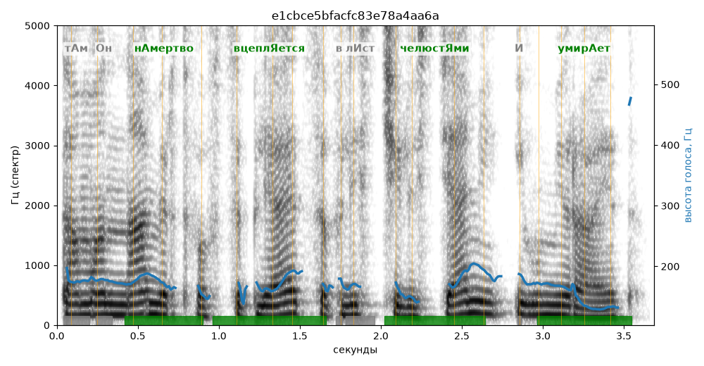

# e1cbce5bfacfc83e78a4aa6a

Естественность (UTMOS): **2.35 из 5** (живой диктор ≈ 4–4.5)
Эталон: Там он н+амертво вцепл+яется в лист челюст+ями и умир+ает.
Распознано: Там она мертво вцепляется в лес челюстями и умирает.
Расхождения в словах: «он намертво» → «она мертво»; «лист» → «лес»

## Ударения
(где нужно: дано в тексте)

| слово | нужно | у голоса | |
|---|---|---|---|
| намертво | нАмертво | нАмертво | ✓ |
| вцепляется | вцеплЯется | вцеплЯется | ✓ |
| челюстями | челюстЯми | челюстЯми | ✓ |
| умирает | умирАет | умирАет | ✓ |

## Интонация
- ✓ «там он намертво вцепляется в лист челюстями и умирает.» — конец фразы понижается — звучит законченно
- Диапазон голоса 6.7 полутонов (нормально), средняя высота 171 Гц

## Паузы и темп
- паузы на своих местах
- Темп 6.1 слога/с (нормально)

_Синяя линия — высота голоса. Над словами заглавная буква — где ударение должно быть; красным — голос поставил не туда (уверенно), оранжевым — возможно._
