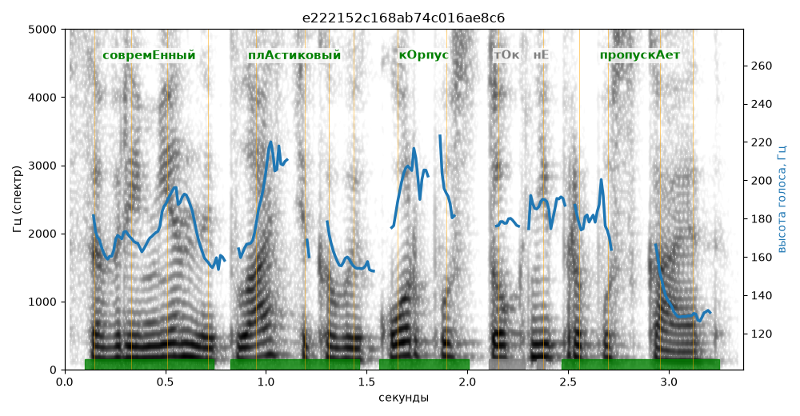

# e222152c168ab74c016ae8c6

Естественность (UTMOS): **3.5 из 5** (живой диктор ≈ 4–4.5)
Эталон: Соврем+енный пл+астиковый к+орпус т+ок не пропуск+ает.
Распознано: Современный пластиковый корпус ток не пропускает.
Слова: все совпали

## Ударения
(где нужно: дано в тексте)

| слово | нужно | у голоса | |
|---|---|---|---|
| современный | совремЕнный | совремЕнный | ✓ |
| пластиковый | плАстиковый | плАстиковый | ✓ |
| корпус | кОрпус | кОрпус | ✓ |
| пропускает | пропускАет | пропускАет | ✓ |

## Интонация
- ✓ «современный пластиковый корпус ток не пропускает.» — конец фразы понижается — звучит законченно
- Диапазон голоса 8.1 полутонов (живо), средняя высота 174 Гц

## Паузы и темп
- паузы на своих местах
- Темп 5.1 слога/с (нормально)

_Синяя линия — высота голоса. Над словами заглавная буква — где ударение должно быть; красным — голос поставил не туда (уверенно), оранжевым — возможно._
