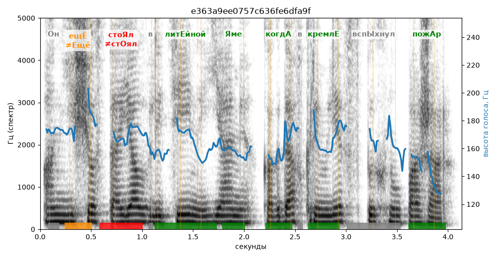

# e363a9ee0757c636fe6dfa9f

Естественность (UTMOS): **3.19 из 5** (живой диктор ≈ 4–4.5)
Эталон: Он ещ+ё сто+ял в лит+ейной +яме, когд+а в Кремл+е всп+ыхнул пож+ар.
Распознано: Он еще стоял в литейной яме, когда в Кремле вспыхнул пожар.
Слова: все совпали

## Ударения
(где нужно: дано в тексте)

| слово | нужно | у голоса | |
|---|---|---|---|
| ещё | ещЁ | Ещё | ✗? возможно — послушать |
| стоял | стоЯл | стОял | ✗ ОШИБКА |
| литейной | литЕйной | литЕйной | ✓ |
| яме | Яме | Яме | ✓ |
| когда | когдА | когдА | ✓ |
| кремле | кремлЕ | кремлЕ | ✓ |
| вспыхнул | вспЫхнул | вспыхнУл | ? не разобрать |
| пожар | пожАр | пожАр | ✓ |

## Интонация
- ✓ «он ещё стоял в литейной яме когда в кремле вспыхнул пожар.» — конец фразы понижается — звучит законченно
- Диапазон голоса 3.3 полутонов (монотонно, как робот), средняя высота 162 Гц

## Паузы и темп
- паузы на своих местах
- Темп 4.9 слога/с (нормально)

_Синяя линия — высота голоса. Над словами заглавная буква — где ударение должно быть; красным — голос поставил не туда (уверенно), оранжевым — возможно._
