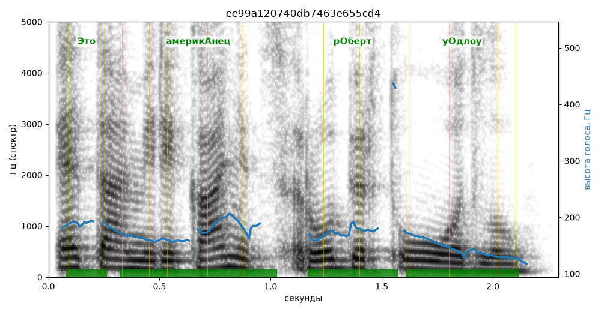

# ee99a120740db7463e655cd4

Естественность (UTMOS): **3.4 из 5** (живой диктор ≈ 4–4.5)
Эталон: +Это америк+анец Р+оберт У+одлоу.

## Ударения
(где нужно: дано в тексте)

| слово | нужно | у голоса | |
|---|---|---|---|
| это | Это | Это | ✓ |
| американец | америкАнец | америкАнец | ✓ |
| роберт | рОберт | рОберт | ✓ |
| уодлоу | уОдлоу | уОдлоу | ✓ |

## Интонация
- ✓ «это американец роберт уодлоу.» — конец фразы понижается — звучит законченно
- Диапазон голоса 7.3 полутонов (живо), средняя высота 167 Гц

## Паузы и темп
- паузы на своих местах
- Темп 6.4 слога/с (нормально)

_Синяя линия — высота голоса. Над словами заглавная буква — где ударение должно быть; красным — голос поставил не туда (уверенно), оранжевым — возможно._
