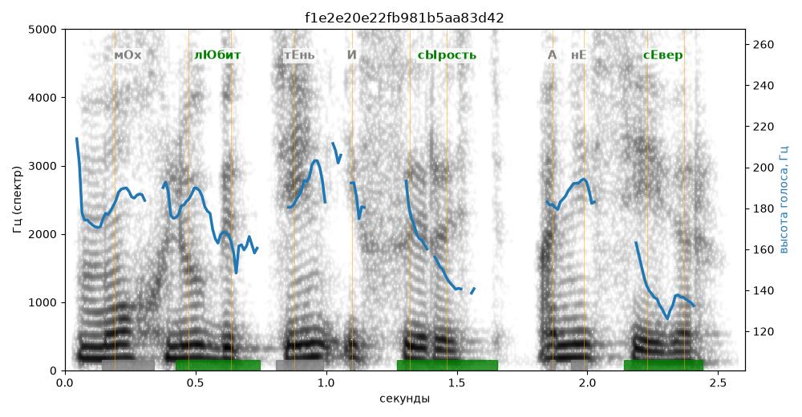

# f1e2e20e22fb981b5aa83d42

Естественность (UTMOS): **3.46 из 5** (живой диктор ≈ 4–4.5)
Эталон: М+ох л+юбит т+ень и с+ырость, а не с+евер.
Распознано: Мох любит тень и сырость, а не север.
Слова: все совпали

## Ударения
(где нужно: дано в тексте)

| слово | нужно | у голоса | |
|---|---|---|---|
| любит | лЮбит | лЮбит | ✓ |
| сырость | сЫрость | сЫрость | ✓ |
| север | сЕвер | сЕвер | ✓ |

## Интонация
- ✓ «мох любит тень и сырость а не север.» — конец фразы понижается — звучит законченно
- Диапазон голоса 7.0 полутонов (живо), средняя высота 178 Гц

## Паузы и темп
- паузы на своих местах
- Темп 5.7 слога/с (нормально)

_Синяя линия — высота голоса. Над словами заглавная буква — где ударение должно быть; красным — голос поставил не туда (уверенно), оранжевым — возможно._
