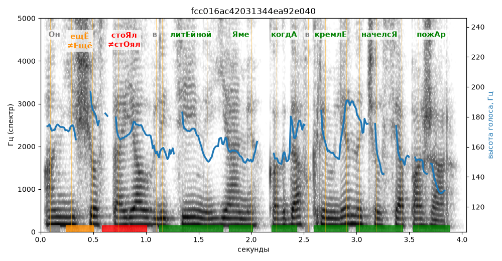

# fcc016ac42031344ea92e040

Естественность (UTMOS): **3.16 из 5** (живой диктор ≈ 4–4.5)
Эталон: Он ещ+ё сто+ял в лит+ейной +яме, когд+а в Кремл+е начелс+я пож+ар.
Распознано: Он еще стоял в литейной яме, когда в Кремле начался пожар.
Расхождения в словах: «начелся» → «начался»

## Ударения
(где нужно: дано в тексте)

| слово | нужно | у голоса | |
|---|---|---|---|
| ещё | ещЁ | Ещё | ✗? возможно — послушать |
| стоял | стоЯл | стОял | ✗ ОШИБКА |
| литейной | литЕйной | литЕйной | ✓ |
| яме | Яме | Яме | ✓ |
| когда | когдА | когдА | ✓ |
| кремле | кремлЕ | кремлЕ | ✓ |
| начелся | начелсЯ | начелсЯ | ✓ |
| пожар | пожАр | пожАр | ✓ |

## Интонация
- ✓ «он ещё стоял в литейной яме когда в кремле начелся пожар.» — конец фразы понижается — звучит законченно
- Диапазон голоса 4.4 полутонов (монотонно, как робот), средняя высота 163 Гц

## Паузы и темп
- паузы на своих местах
- Темп 5.3 слога/с (нормально)

_Синяя линия — высота голоса. Над словами заглавная буква — где ударение должно быть; красным — голос поставил не туда (уверенно), оранжевым — возможно._
